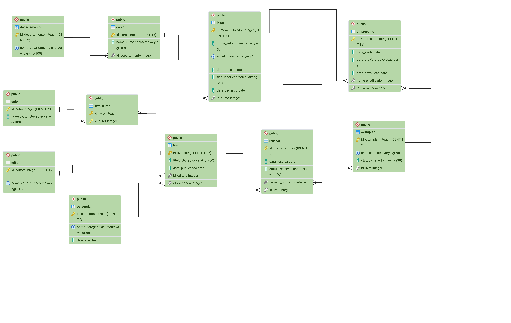
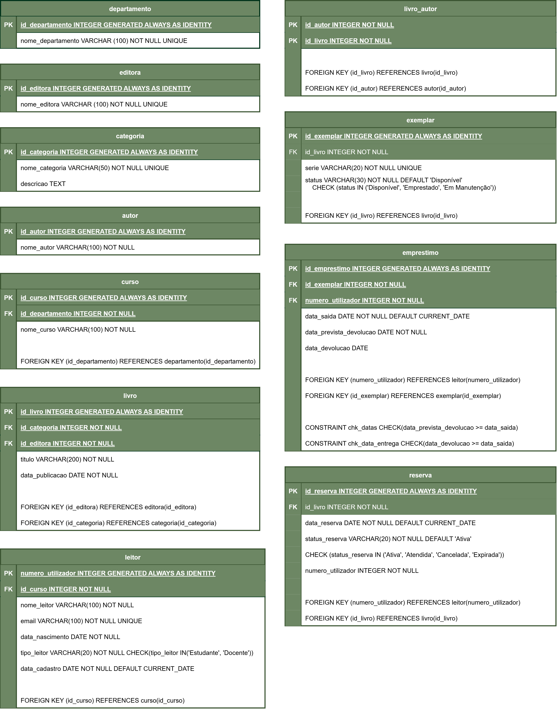

# Sistema de Gestão de Biblioteca Universitária

**UFCD 10797 - Gestão e Armazenamento de Dados**

Projeto de base de dados para analisar um cenário real, modelar uma base de dados relacional em PostgreSQL e responder a consultas SQL de diferentes níveis de dificuldade.

## Objetivo

Substituir o registo manual das operações da biblioteca por um sistema estruturado de gestão de dados para organizar a informação relativa ao acervo bibliográfico, aos leitores e aos empréstimos.

## Estrutura da Base de Dados

O sistema foi estruturado em 10 entidades e uma tabela intermédia para tratar cardinalidade N:M, divididas nos seguintes domínios:

**Organizacionais:**

* Departamento: representa os departamentos académicos da universidade.
* Curso: representa os cursos existentes, estando cada curso associado a um departamento.

**Utilizadores:**

* Leitor: representa os utilizadores da biblioteca, podendo ser estudantes ou docentes.

**Acervo Bibliográfico:**

* Categoria: permite classificar os livros de acordo com a sua área ou temática.
* Editora: representa as editoras responsáveis pela publicação dos livros.
* Autor: representa os autores das obras disponíveis na biblioteca.
* Livro: representa as obras disponíveis para empréstimo, incluindo título e data de publicação.
* Exemplar: representa cada exemplar físico de um livro disponível para empréstimo.
* Livro - Autor: tabela intermédia utilizada para representar a relação muitos-para-muitos entre livros e autores.

**Circulação:**

* Empréstimos: regista os empréstimos realizados pelos leitores, incluindo as respetivas datas e o exemplar.
* Reserva: regista as reservas efetuadas pelos leitores para os livros.


### Diagrama Entidade-Relacionamento (DER)



### Esquema Lógico



## Principais Regras de Negócio

**Tipos de Leitor:** Limitados a `'Estudante'` ou `'Docente'`.

**Estados dos Exemplares:** `'Disponível'`, `'Emprestado'` ou `'Em Manutenção'`.

**Estados das Reservas:** `'Ativa'`, `'Atendida'`, `'Cancelada'` ou `'Expirada'`.

**Validação de Datas:** As datas previstas e efetivas de devolução não podem ser anteriores à data de saída.

**Cálculo de Multas:** Atrasos na devolução aplicam uma penalização de _0,50 €_ por dia calculada em consulta.

## Dados de Teste (Povoamento)

Para validar a estrutura relacional e viabilizar a execução das consultas analíticas, foi definido um volume mínimo de registos de teste para povoar as tabelas. Os registos estão disponíveis nos scripts de inserção neste repositório.

| Tabela | Mínimo Solicitado | Registos Inseridos |
| :--- | :---: | :---: |
| Departamentos | 4 | 9 |
| Cursos | 8 | 13 |
| Categorias | 6 | 11 |
| Editoras | 6 | 32 |
| Autores | 15 | 66 |
| Livros | 30 | 35 |
| Livro_Autor | 40 | 44 |
| Exemplares | — | 105 |
| Leitores | 25 | 61 |
| Empréstimos | 80 | 97 |

As entidades `exemplar` e `reserva` não estavam previstas no enunciado e foram desenvolvidas por iniciativa própria durante a modelação para representar de forma um pouco mais realista a gestão do acervo e circulação.

## Tecnologias e Ferramentas

**SGBD:** PostgreSQL versão 18.4

**Gestão e Modelação:** pgAdmin 4 versão 9.15

**Estrutura lógica:** draw.io

## Execução do Projeto

**Criar a base de dados:**
   ```sql
   CREATE DATABASE unibiblio;
   ```

**Criar as tabelas:**

Executar o script de criação das tabelas (`parte_a_create_table_unibiblio.sql`).


**Povoar a base de dados:**

É importante respeitar a ordem de dependência das tabelas:
* Executar primeiro o script da estrutura organizacional e acervo  (`parte_b01_inserts.sql`).

* De seguida, executar o script de utilizadores e circulação (`parte_b02_inserts.sql`).


**Explorar as consultas:**

Execute os ficheiros de consultas organizados por nível de dificuldade:
* `parte_c_queries_faceis.sql` (10 consultas de seleção, ordenação e filtragem)

* `parte_d_queries_medias.sql` (10 consultas com `JOIN`, `LEFT JOIN`, `GROUP BY`, `COUNT` e `HAVING`)

* `parte_e_queries_dificeis.sql` (5 consultas analíticas com subconsultas, `WITH` / CTEs, `FETCH FIRST ... WITH TIES` e `DENSE_RANK()`)

## Evolução do Projeto

Versão inicial entregue em setembro de 2026.

Futuras atualizações incluirão a automatização de regras de negócio com triggers e novas consultas analíticas.